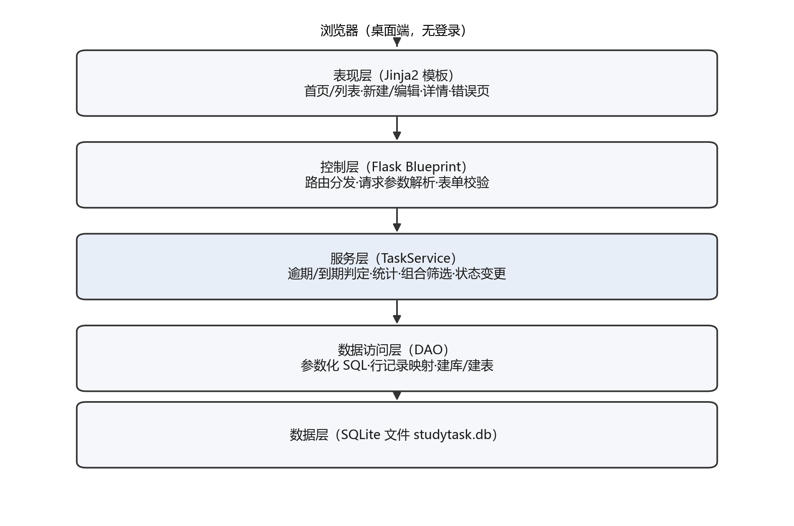
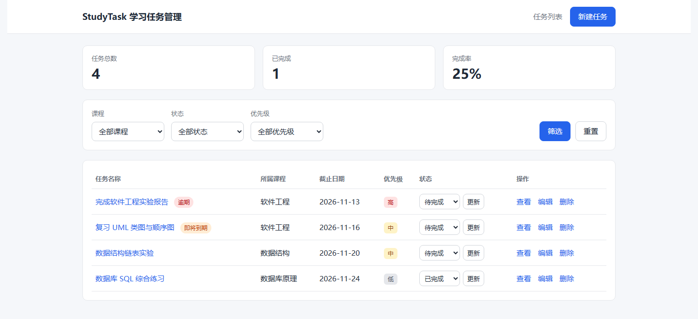

# StudyTask 个人学习任务管理系统 · 实验报告

课程：软件工程　实验：实验一　日期：2026-11-15

## 1 实验目标与需求范围

本实验依据《StudyTask 需求规格说明书》（附录 A），实现一个单用户、本地运行的个人学习任务管理系统。系统以浏览器访问，数据保存在本机 SQLite 数据库中，不需要登录与网络。

需求范围覆盖 SRS 的 FR-01 至 FR-10：任务创建、列表与详情、修改、删除确认、状态调整、按课程/状态/优先级组合筛选、逾期与即将到期标记、首页统计、数据持久化、中文界面与错误提示。明确不实现 SRS A.5 列出的注册登录、多用户、共享任务、通知、日历同步、移动端与云部署。验收依据 A.6：可按 README 运行、核心功能实际验证、严重缺陷修复、交付物齐全。



## 2 实现方案

**技术选型**：Python 3.10+、Flask 3.x、SQLite（标准库 sqlite3）、Jinja2 服务端渲染、pytest。未使用 ORM 与前端框架，运行期仅依赖 Flask。

**系统结构**：采用四层结构（图 1）。表现层为 Jinja2 模板；控制层为 Flask Blueprint，负责路由与参数处理；服务层 `task_service.py` 集中实现校验、筛选、统计、逾期判定与增删改；数据访问层以参数化 SQL 读写 SQLite。应用由 `create_app()` 工厂创建，首次启动自动执行 `schema.sql` 建表。

**数据库设计**：单表 `tasks`，字段与约束对应 SRS A.2，并对长度、日期格式、优先级与状态枚举加 `CHECK` 约束；为截止日期、课程、状态、优先级建立索引。

| 字段                      | 类型/约束           | 说明      |
| ----------------------- | --------------- | ------- |
| id                      | INTEGER 主键自增    | 任务 ID   |
| title                   | TEXT，1—100 字    | 任务名称    |
| course                  | TEXT，1—60 字     | 所属课程    |
| description             | TEXT，≤1000 字    | 任务描述    |
| due_date                | TEXT，YYYY-MM-DD | 截止日期    |
| priority                | 高/中/低           | 默认“中”   |
| status                  | 待完成/进行中/已完成     | 默认“待完成” |
| created_at / updated_at | 时间戳             | 自动维护    |

**关键规则**：逾期 = 未完成且截止日期早于今天；即将到期 = 未完成且距今 0—3 天（含边界）；完成率 = 已完成数 ÷ 总数 × 100%，四舍五入，总数为 0 时显示 0%；列表按截止日期升序、优先级降序、创建时间倒序排列；写操作统一 POST + 重定向（PRG），删除使用独立确认页。

## 3 实施过程

开发按“设计—编码—测试—打磨”推进：

1. 依据 SRS 编写《设计说明书》，确定分层、表结构、路由与业务规则；
2. 搭建应用工厂、数据库与模板骨架，完成创建/列表/详情；
3. 补充编辑、删除确认、状态调整、组合筛选与统计；
4. 编写 pytest 用例，修正相对导入、状态更新等问题；
5. 用浏览器逐页验证，并统一页面居中与字体样式。

AI 参与需求解析、代码生成、测试补齐与界面调整；本人负责确认设计取舍（如新建任务固定“待完成”、统计不随筛选变化）、运行验证与缺陷判断。

## 4 测试结果

自动化测试使用 pytest 与临时数据库，共 **18 项全部通过**，覆盖创建校验、非法日期、详情 404、编辑、删除、状态变更、组合筛选、非法筛选忽略、统计与完成率、逾期/即将到期边界、重启持久化、排序。

| 测试类别   | 代表用例             | 结果  |
| ------ | ---------------- | --- |
| 创建与校验  | 空名称、超长名称、非法日期    | 通过  |
| 查询与编辑  | 详情、404、编辑后一致性    | 通过  |
| 删除与状态  | 确认删除、非法状态拒绝      | 通过  |
| 筛选与统计  | 组合条件、完成率 67%/25% | 通过  |
| 持久化与排序 | 重启后数据仍在、按截止日期排序  | 通过  |

手工验收同样通过：按 README 启动后可完成全流程操作；非法输入有中文提示且不崩溃；关闭并重启应用后数据保持；200 条任务量级下列表操作正常。



## 5 结果分析

系统完整覆盖 FR-01 至 FR-10，A.6 的四项验收标准均有对应证据：README 可运行、核心功能经自动化与手工双重验证、测试中未发现严重缺陷、源码/依赖/测试/文档齐全。

设计上的主要收益是分层清晰：业务规则集中在服务层，路由只做参数与渲染，模板不含判断逻辑，因此修改规则或补充用例成本较低。SQLite 单文件也满足“关闭后数据不变”的要求。

不足与限制：单用户单进程，未处理并发写冲突；日期判断依赖本机时区；未实现分页，任务量很大时列表会变长；界面按桌面场景设计，窄窗口下任务表需要横向滚动。

## 6 问题与反思

**问题一：校验规则重复。** 服务层与数据库都写了长度、枚举约束，早期出现提示文案与约束不一致。处理：以服务端校验为唯一提示来源，数据库约束只做最后防线，二者规则表统一维护。

**问题二：删除误操作风险。** 初版用链接直接删除，容易误点。处理：改为“确认页 + POST 执行”，并在确认页显示任务名称、课程与截止日期。

**问题三：新建与编辑的状态字段。** 设计初稿两处都允许选状态，与“新建固定待完成”不一致。处理：新建页隐藏状态字段，编辑页保留，并回写设计说明书 6.2 节。

反思：先写设计再编码显著减少了返工；自动化测试应覆盖边界（今天、第 3 天、第 4 天）而不只是主流程；AI 生成的代码必须通过实际运行与测试验证，不能以“已生成”代替“已正确”。

## 附录 运行方式

```bash
pip install -r requirements.txt
python run.py      # http://127.0.0.1:5000
pytest -q          # 18 项测试
```

项目结构：`app/`（工厂、配置、数据访问、模型、服务、视图、模板、样式）、`tests/`、`schema.sql`、`run.py`、`docs/`（设计说明书与本文）。
