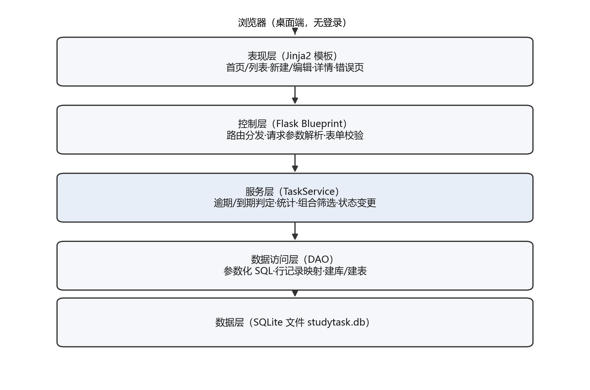
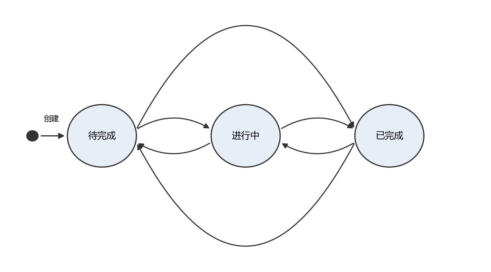
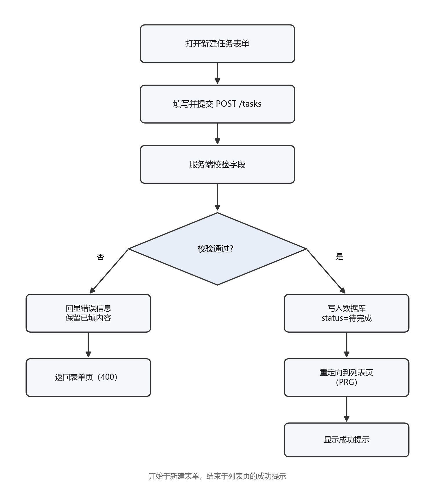
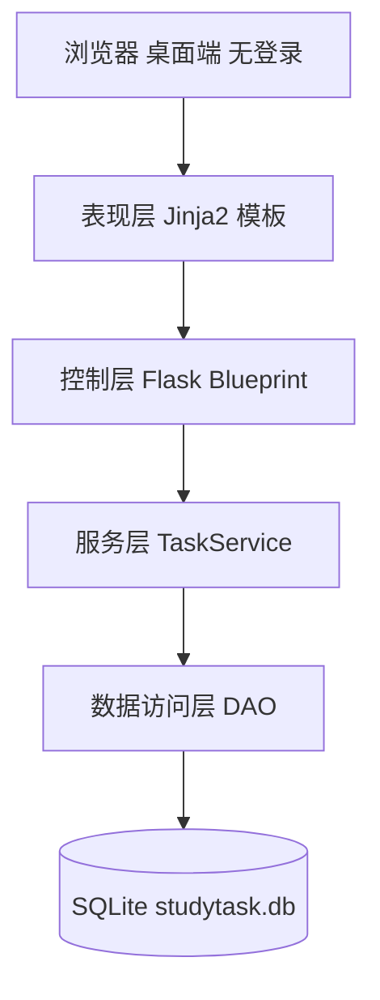
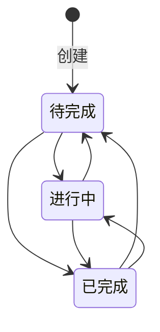
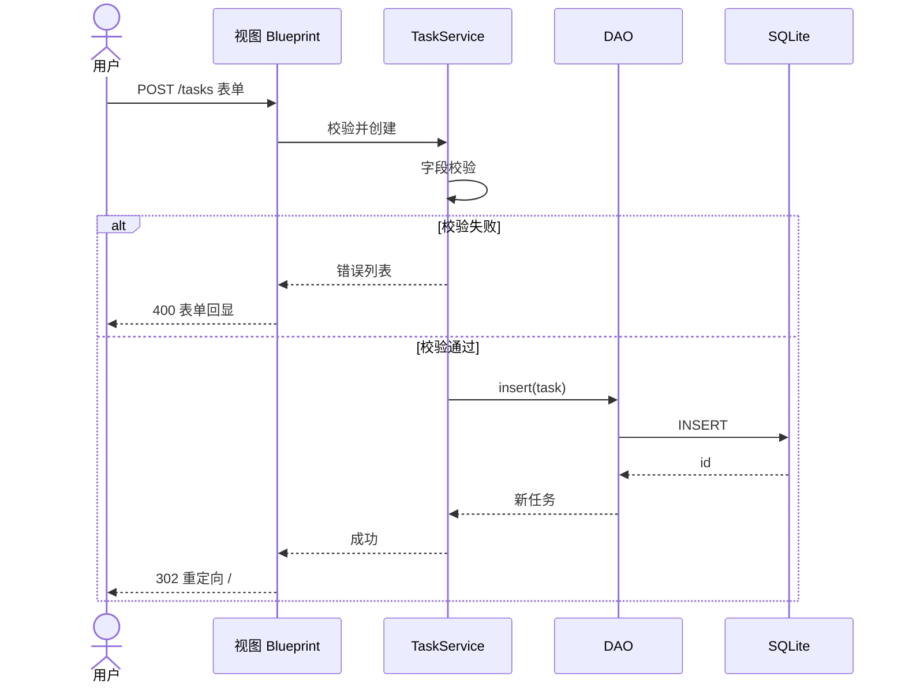

# 文档修订记录

| 版本 | 日期 | 修订内容 | 修订人 |
| --- | --- | --- | --- |
| v1.0 | 2026-11-15 | 首次编写，依据《StudyTask 需求规格说明书》完成总体、数据、功能、接口、界面与非功能设计 | 待填写 |

# 1 引言

## 1.1 编写目的

本文档把《StudyTask 需求规格说明书》（以下简称 SRS）中“做什么”的需求描述，转换为“怎么做”的设计方案，作为后续编码、自测、验收与维护的统一依据。

本文档的读者为：本项目的实现者（学生本人）、课程评阅教师，以及后续需要接手维护该项目的同学。

## 1.2 设计范围

本文档覆盖 SRS 附录 A 的全部内容：

- A.1 产品定义：系统名称、目标用户、运行方式与技术边界；
- A.2 数据项：任务的字段、类型与约束；
- A.3 功能性需求：FR-01 至 FR-10；
- A.4 非功能性需求：单用户本地运行、中文界面、浏览器兼容、交付物要求等；
- A.6 验收标准。

本文档**不覆盖** SRS 的 A.5 范围外需求：用户注册、多用户权限、共享任务、邮件/短信通知、第三方日历同步、移动 App、云部署。设计中对这些能力不做预留实现，仅在 13.3 节说明可扩展方向。

本文档只描述设计，不包含完整源代码实现。

## 1.3 术语与缩略语

| 术语 | 说明 |
| --- | --- |
| SRS | 软件需求规格说明书，本文指《StudyTask 需求规格说明书》 |
| FR | 功能性需求（Functional Requirement），编号 FR-01 至 FR-10 |
| NFR | 非功能性需求（Non-Functional Requirement） |
| DAO | 数据访问对象，封装对数据库的读写 |
| ORM | 对象关系映射框架，如 SQLAlchemy；本项目不使用 |
| DDL | 数据定义语言，指建表、建索引语句 |
| PRG | Post/Redirect/Get 模式，用于避免刷新导致的重复提交 |
| 逾期 | 未完成且截止日期早于当前日期的任务状态标记 |
| 即将到期 | 未完成且截止日期在当前日期起 3 天内（含边界）的标记 |
| 完成率 | 已完成任务数占任务总数的百分比 |

## 1.4 参考文档

1. 《StudyTask 需求规格说明书》，附录 A（A.1—A.6）。
2. 课程实验指导书附录 D.5“代码仓库结构参考”。
3. Python 官方文档、Flask 官方文档、SQLite 官方文档。

## 1.5 与需求文档的关系

本文档的每个设计章节都可追溯到具体的需求条文，对应关系见第 12 章“需求追踪矩阵”。设计中对 SRS 未明确、但实现必须确定的细节，统一以“设计决策”形式给出（见 2.5 节），并说明理由，便于评审时确认。

# 2 系统概述

## 2.1 产品定位

StudyTask 是面向单个在校大学生的个人学习任务管理系统。系统以本地 Web 应用方式运行，用户通过桌面浏览器访问，数据保存在本机 SQLite 数据库中，不需要登录，也不需要联网。

## 2.2 设计目标与约束

| 类别 | 内容 |
| --- | --- |
| 功能目标 | FR-01 至 FR-10 全部可操作、可演示 |
| 数据目标 | 所有任务数据在应用关闭并重新启动后保持不变（FR-09） |
| 质量目标 | 正常数据规模（200 条任务）下可正常操作；错误输入不导致应用崩溃 |
| 技术约束 | Python + Flask + SQLite（SRS A.1 建议技术边界） |
| 运行约束 | 单用户、单机、本地浏览器访问、无登录、无远程服务器 |
| 交付约束 | 提供 requirements.txt 与 README，含初始化、运行与测试说明（SRS A.4） |
| 界面约束 | 界面文字为中文，提供基本错误提示（FR-10）；不强制特定前端框架 |

## 2.3 运行环境

| 项目 | 要求 |
| --- | --- |
| 操作系统 | Windows 10/11、macOS 12+、主流 Linux 发行版 |
| Python | 3.10 及以上（使用标准库 sqlite3 与 pathlib） |
| 第三方库 | Flask 3.x；pytest 8.x（仅开发/测试使用） |
| 数据库 | SQLite 3（随 Python 内置，无需单独安装） |
| 浏览器 | Chrome、Edge、Firefox 近两年内的桌面版本 |
| 硬件 | 普通个人电脑即可；应用数据文件小于 10 MB（200 条任务量级） |
| 网络 | 不需要互联网连接 |

## 2.4 设计原则

1. **简单优先**：单用户本地场景，不引入 ORM、前端框架、消息队列等额外复杂度。
2. **服务端校验为准**：所有输入校验在服务端执行，数据库约束作为最后一道防线。
3. **单一数据源**：列表、详情、统计都从同一张 `tasks` 表读取，避免数据不一致。
4. **请求无状态**：不依赖服务端会话保存业务数据，刷新与重启不改变业务状态。
5. **参数化访问**：所有 SQL 使用参数绑定，不拼接用户输入。
6. **可测试**：业务规则集中在服务层，便于用 pytest 直接验证。
7. **最小依赖**：运行期仅依赖 Flask，降低安装与交付成本。

## 2.5 关键设计决策摘要

| 编号 | 设计决策 | 理由 |
| --- | --- | --- |
| DD-01 | 采用 Flask 应用工厂 + Blueprint + 服务层 + DAO 的四层结构 | 职责清晰，便于单测与后续维护 |
| DD-02 | 使用标准库 sqlite3，不使用 ORM | 数据模型仅一张表，ORM 收益低、依赖成本高 |
| DD-03 | 使用 Jinja2 服务端渲染，不使用前端框架 | SRS 不强制前端框架，服务端渲染最简单 |
| DD-04 | 三种状态之间允许任意切换 | SRS FR-05 只要求“能调整”，未规定单向流转 |
| DD-05 | 逾期：截止日期 < 今天且未完成；即将到期：今天 ≤ 截止日期 ≤ 今天+3 天且未完成 | 落实 FR-07；“未来 3 天”按含边界处理 |
| DD-06 | 完成率保留整数，四舍五入；总数为 0 时显示 0% | 落实 FR-08，并明确除零处理 |
| DD-07 | 首页统计基于全部任务，不随筛选条件变化 | SRS 未说明统计口径，固定口径可避免歧义 |
| DD-08 | 列表默认按截止日期升序、优先级降序、创建时间倒序 | 让最紧急的任务靠前，符合任务管理直觉 |
| DD-09 | 不实现分页，直接展示全部任务 | SRS 未要求分页，200 条量级单页可接受 |
| DD-10 | 截止日期以 `YYYY-MM-DD` 文本存储 | 与 SRS A.2 格式一致，SQLite 中可直接比较排序 |
| DD-11 | 筛选参数非法（如 status=未知值）时忽略该条件并提示 | 避免报错中断，同时不隐藏问题 |
| DD-12 | 写操作统一使用 POST + PRG，避免刷新重复提交 | 提升健壮性，成本低 |
| DD-13 | 删除使用独立确认页 + POST，不使用 GET 链接 | 防止误删与被浏览器预取触发 |
| DD-14 | 不做并发控制与多用户隔离 | SRS 明确单用户本地使用，超出范围 |

## 2.6 需求覆盖概览

| 需求编号 | 需求要点 | 设计章节 |
| --- | --- | --- |
| FR-01 | 创建任务并校验名称、课程、截止日期 | 5.1、6.2、7.7 |
| FR-02 | 列表展示关键字段并进入详情 | 5.2、6.1、8.2 |
| FR-03 | 修改任务，列表与详情保持一致 | 5.3、6.1 |
| FR-04 | 删除前确认，确认后删除 | 5.4、8.5 |
| FR-05 | 三种状态之间调整 | 5.5、4.5 |
| FR-06 | 按课程、状态、优先级组合筛选 | 5.6、6.3、7.5 |
| FR-07 | 逾期与即将到期标记 | 5.7、7.2、7.3 |
| FR-08 | 首页统计总数、已完成数与完成率 | 5.8、7.4 |
| FR-09 | 数据在重启后保持 | 5.9、4.7 |
| FR-10 | 中文界面、错误提示、不崩溃 | 5.10、8.7、9 |
| A.4 NFR | 单用户、兼容性、交付物等 | 10 |

# 3 总体设计

## 3.1 架构风格与分层

系统采用经典的四层结构，自上而下为：

1. **表现层**：Jinja2 模板负责页面渲染，只做展示与简单交互，不含业务判断。
2. **控制层**：Flask Blueprint 接收请求，解析参数，调用服务层，选择模板或重定向。
3. **服务层**：集中实现业务规则，包括字段校验、逾期与到期判定、统计、组合筛选、状态变更。
4. **数据访问层**：DAO 以参数化 SQL 完成增删改查，返回字典形式的数据行。

数据库为单个 SQLite 文件，由数据访问层统一管理连接与初始化。

## 3.2 逻辑架构



图 3-1 说明：浏览器发起的每个请求依次经过表现层、控制层、服务层和数据访问层；没有任何跨层直接调用，模板不直接访问数据库。

## 3.3 模块划分与职责

| 模块 | 文件 | 职责 |
| --- | --- | --- |
| 应用入口 | `run.py` | 创建应用实例并启动开发服务器 |
| 应用工厂 | `app/__init__.py` | 创建 Flask 应用、注册蓝图、注册错误处理器、初始化数据库 |
| 配置 | `app/config.py` | 数据库路径、密钥、调试开关等配置项 |
| 数据库连接 | `app/db.py` | 建立连接、设置行工厂、提供连接获取与关闭、执行建表脚本 |
| 领域模型 | `app/models.py` | 任务数据结构、枚举取值、字段校验函数 |
| 业务服务 | `app/services/task_service.py` | 创建/修改/删除/状态变更、逾期与到期判定、统计、筛选、排序 |
| 路由视图 | `app/views/tasks.py` | 路由定义、请求参数处理、表单错误回显、重定向 |
| 模板 | `app/templates/` | `base.html`、`index.html`、`task_form.html`、`task_detail.html`、`task_confirm_delete.html`、`error.html` |
| 静态资源 | `app/static/style.css` | 页面样式，不引入前端框架 |
| 建表脚本 | `schema.sql` | 建表与建索引语句，供初始化与测试复用 |

## 3.4 目录结构

```text
StudyTask/
├─ run.py
├─ requirements.txt
├─ README.md
├─ schema.sql
├─ app/
│  ├─ __init__.py
│  ├─ config.py
│  ├─ db.py
│  ├─ models.py
│  ├─ services/
│  │  └─ task_service.py
│  ├─ views/
│  │  └─ tasks.py
│  ├─ templates/
│  │  ├─ base.html
│  │  ├─ index.html
│  │  ├─ task_form.html
│  │  ├─ task_detail.html
│  │  ├─ task_confirm_delete.html
│  │  └─ error.html
│  └─ static/
│     └─ style.css
├─ instance/
│  └─ studytask.db
└─ tests/
```

目录结构与实验指导书 D.5 的建议保持一致：应用代码集中在 `project` 语义的 `app/` 下，测试在 `tests/`，文档在 `docs/`，根目录提供 `README.md` 与 `requirements.txt`。

## 3.5 运行时流程

**启动流程**

1. `run.py` 调用 `create_app()`。
2. 应用工厂读取配置，确定数据库文件路径。
3. 若数据库文件不存在，创建 `instance/` 目录并执行 `schema.sql` 建表与建索引。
4. 注册任务蓝图与错误处理器。
5. 启动本地开发服务器，等待浏览器请求。

**请求流程（以查看列表为例）**

1. 浏览器请求 `GET /`。
2. 控制层读取 `course`、`status`、`priority` 查询参数。
3. 服务层校验并规范化筛选条件，调用 DAO 查询任务列表。
4. 服务层计算每条任务的“逾期/即将到期”标记，并计算首页统计。
5. 控制层把结果交给 `index.html` 渲染。
6. 返回 HTML 响应。

## 3.6 依赖与配置

运行期依赖仅 `flask`；开发与自测使用 `pytest`。`requirements.txt` 至少包含：

```text
Flask>=3.0
pytest>=8.0
```

主要配置项：

| 配置项 | 说明 | 默认值 |
| --- | --- | --- |
| `DATABASE` | SQLite 数据库文件路径 | `instance/studytask.db` |
| `SECRET_KEY` | 用于 flash 提示消息的会话签名 | 本地随机字符串 |
| `DEBUG` | 调试开关 | 开发时 `True`，交付时 `False` |

# 4 数据设计

## 4.1 数据模型

系统只有任务（Task）一个实体，没有其他实体之间的关联，因此不需要外键。任务实体由 SRS A.2 的九个数据项构成，另加一个系统主键用于唯一定位记录。

## 4.2 表结构

表名：`tasks`

| 字段 | 类型 | 约束 | 默认值 | 说明 |
| --- | --- | --- | --- | --- |
| `id` | INTEGER | 主键、自增、唯一 | 自动 | 对应 SRS“任务ID” |
| `title` | TEXT | 非空，长度 1—100 | 无 | 任务名称 |
| `course` | TEXT | 非空，长度 1—60 | 无 | 所属课程 |
| `description` | TEXT | 可空，长度不超过 1000 | 空字符串 | 任务描述 |
| `due_date` | TEXT | 非空，格式 `YYYY-MM-DD` | 无 | 截止日期 |
| `priority` | TEXT | 非空，取值 高/中/低 | 中 | 优先级 |
| `status` | TEXT | 非空，取值 待完成/进行中/已完成 | 待完成 | 状态 |
| `created_at` | TEXT | 非空 | 当前时间 | 创建时间 |
| `updated_at` | TEXT | 非空 | 当前时间 | 更新时间 |

时间字段统一使用 `YYYY-MM-DD HH:MM:SS` 文本存储，便于阅读与比对；不涉及时区换算。

## 4.3 建表 DDL

```sql
CREATE TABLE IF NOT EXISTS tasks (
    id          INTEGER PRIMARY KEY AUTOINCREMENT,
    title       TEXT    NOT NULL,
    course      TEXT    NOT NULL,
    description TEXT    NOT NULL DEFAULT '',
    due_date    TEXT    NOT NULL,
    priority    TEXT    NOT NULL DEFAULT '中',
    status      TEXT    NOT NULL DEFAULT '待完成',
    created_at  TEXT    NOT NULL,
    updated_at  TEXT    NOT NULL,
    CONSTRAINT ck_title_len   CHECK (length(title) BETWEEN 1 AND 100),
    CONSTRAINT ck_course_len  CHECK (length(course) BETWEEN 1 AND 60),
    CONSTRAINT ck_desc_len    CHECK (length(description) <= 1000),
    CONSTRAINT ck_due_format  CHECK (due_date GLOB
        '[0-9][0-9][0-9][0-9]-[0-9][0-9]-[0-9][0-9]'),
    CONSTRAINT ck_priority    CHECK (priority IN ('高', '中', '低')),
    CONSTRAINT ck_status      CHECK (status IN ('待完成', '进行中', '已完成'))
);
```

说明：`CHECK` 中的 `length()` 对中文按字符计数，符合“1—100 字”的要求；`GLOB` 只校验格式，日期是否为真实日期（如 2 月 30 日）由服务层用日期解析函数校验。

## 4.4 索引设计

| 索引 | 字段 | 目的 |
| --- | --- | --- |
| `idx_tasks_due` | `due_date` | 默认排序与逾期判断 |
| `idx_tasks_course` | `course` | 按课程筛选 |
| `idx_tasks_status` | `status` | 按状态筛选、统计已完成数 |
| `idx_tasks_priority` | `priority` | 按优先级筛选与排序 |

数据量仅数百条，索引不是性能必需，但与筛选和排序的实现一致，成本可忽略。

## 4.5 状态模型



| 当前状态 | 可切换到 | 触发入口 | 副作用 |
| --- | --- | --- | --- |
| 待完成 | 进行中、已完成 | 列表行内按钮、详情页 | 更新 `updated_at` |
| 进行中 | 待完成、已完成 | 列表行内按钮、详情页 | 更新 `updated_at` |
| 已完成 | 待完成、进行中 | 列表行内按钮、详情页 | 更新 `updated_at`；不再显示逾期/即将到期 |

新建任务固定以“待完成”入库；状态变更必须提交三个合法值之一，其他值拒绝。

## 4.6 数据校验规则

| 字段 | 服务端规则 | 失败表现 |
| --- | --- | --- |
| 任务名称 | 去除首尾空白后非空，长度 1—100 字符 | 表单回显“任务名称不能为空/不能超过 100 字” |
| 所属课程 | 去除首尾空白后非空，长度 1—60 字符 | 回显“所属课程不能为空/不能超过 60 字” |
| 任务描述 | 可空，长度不超过 1000 字符 | 回显“任务描述不能超过 1000 字” |
| 截止日期 | 非空，匹配 `YYYY-MM-DD`，且能解析为真实日期 | 回显“请填写合法的截止日期” |
| 优先级 | 必须是 高/中/低 之一 | 回显“优先级取值非法” |
| 状态 | 必须是 待完成/进行中/已完成 之一 | 拒绝变更并提示 |
| 创建/更新时间 | 由服务端生成，不接受用户输入 | — |

校验顺序为：类型与长度 → 枚举取值 → 日期解析 → 业务规则。任一失败即停止后续处理，返回带错误信息的表单页。

## 4.7 持久化与初始化

- 数据库文件位于 `instance/studytask.db`，随项目目录保存。
- 首次启动时若文件不存在，自动创建目录并执行 `schema.sql`；重复启动不重建、不清空。
- 应用不在内存中保存任务副本，所有读写都直接落到 SQLite，因此进程重启后数据自然保持（FR-09）。
- 备份方式：直接复制 `instance/studytask.db` 文件。
- 不提供数据导入、导出、清空功能（SRS 未要求）。

# 5 功能设计

## 5.1 FR-01 创建任务

**需求条文**（SRS A.3 FR-01）：用户能通过表单创建任务，必须检查名称、课程和截止日期的有效性。

**输入**：任务名称、所属课程、任务描述、截止日期、优先级、状态。

**前置条件**：无。

**处理流程**

1. 用户从首页点击“新建任务”，进入 `GET /tasks/new`。
2. 表单默认值：优先级“中”，状态“待完成”，其余为空。
3. 提交后进入 `POST /tasks`，服务层逐字段校验。
4. 校验通过：生成 `created_at` 与 `updated_at`，以“待完成”入库。
5. 入库成功后重定向到列表页（PRG），显示“任务创建成功”。
6. 校验失败：返回表单页，保留已填内容，在对应字段旁显示错误。

**校验与异常**：见 4.6 与 9.1；名称、课程、截止日期任一无效都不写库。

**输出与界面**：成功后列表页出现新任务；失败时停留在表单页。

**对应路由**：`GET /tasks/new`、`POST /tasks`。

## 5.2 FR-02 列表与详情

**需求条文**（FR-02）：用户能在列表中看到任务名称、课程、截止日期、状态和优先级，并进入详细信息页面。

**列表页内容**

| 列 | 数据来源 | 说明 |
| --- | --- | --- |
| 任务名称 | `title` | 同时作为进入详情的链接 |
| 所属课程 | `course` | 纯文本 |
| 截止日期 | `due_date` | 附“逾期”“即将到期”标记 |
| 优先级 | `priority` | 高/中/低 |
| 状态 | `status` | 可在行内调整 |
| 操作 | — | 查看、编辑、删除 |

**详情页内容**：任务名称、所属课程、任务描述、截止日期、优先级、状态、创建时间、更新时间，以及状态切换、编辑、删除入口。

**异常**：任务不存在时返回 404 页面（见 9.2）。

**对应路由**：`GET /`、`GET /tasks/<id>`。

## 5.3 FR-03 修改任务

**需求条文**（FR-03）：用户能修改任务各字段；修改成功后列表与详情保持一致。

**处理流程**

1. 列表或详情页点击“编辑”，进入 `GET /tasks/<id>/edit`，表单预填当前值。
2. 提交 `POST /tasks/<id>`，服务层按与创建相同的规则校验。
3. 校验通过：更新字段并刷新 `updated_at`，重定向到详情页并提示“修改成功”。
4. 校验失败：返回表单页并回显错误，不修改数据库。

**一致性保障**：列表、详情、统计均实时读取同一张表，不存在副本，因此修改后各页面天然一致。

**对应路由**：`GET /tasks/<id>/edit`、`POST /tasks/<id>`。

## 5.4 FR-04 删除任务

**需求条文**（FR-04）：用户能删除任务；删除前要求确认，并在确认后从数据库删除。

**处理流程**

1. 列表或详情页点击“删除”，进入确认页 `GET /tasks/<id>/delete`。
2. 确认页显示任务名称、所属课程与截止日期，提供“确认删除”和“取消”两个按钮。
3. “确认删除”提交 `POST /tasks/<id>/delete`，服务层执行删除并重定向到列表页，提示“删除成功”。
4. “取消”返回来源页，不产生任何写操作。

**设计说明**：删除使用 POST，避免浏览器预取或误点链接导致数据丢失；删除为物理删除，不保留回收站（SRS 未要求）。

**对应路由**：`GET /tasks/<id>/delete`、`POST /tasks/<id>/delete`。

## 5.5 FR-05 状态调整

**需求条文**（FR-05）：用户能将任务状态在“待完成、进行中、已完成”间调整。

**处理流程**

1. 列表行内提供状态下拉框，详情页提供状态按钮组。
2. 选择后提交 `POST /tasks/<id>/status`，携带目标状态。
3. 服务层校验目标状态合法性，更新 `status` 与 `updated_at`。
4. 重定向回来源页并提示“状态已更新”。

**规则**：允许任意三态之间切换（DD-04）；状态改为“已完成”后，该任务不再显示逾期与即将到期标记。

**对应路由**：`POST /tasks/<id>/status`。

## 5.6 FR-06 组合筛选

**需求条文**（FR-06）：用户能按课程、状态和优先级筛选任务；支持组合条件。

**实现方式**：首页顶部提供课程下拉框、状态下拉框、优先级下拉框与“筛选”“重置”按钮，以查询参数提交 `GET /`。

**规则**

1. 三个条件之间为“与”关系，同时生效。
2. 条件为空表示不限制该维度。
3. 课程下拉框的选项来自当前全部任务中出现过的课程，另加“全部课程”。
4. 参数非法（如 `status=未知`）时忽略该条件，并在页面提示“筛选条件已忽略”（DD-11）。
5. 筛选只影响列表，不影响首页统计（DD-07）。

**对应路由**：`GET /`（带查询参数）。

## 5.7 FR-07 逾期与即将到期

**需求条文**（FR-07）：对未完成且截止日期早于当前日期的任务标记“逾期”；在今日起未来 3 天内到期的未完成任务标记“即将到期”；已完成任务不显示逾期提醒。

**判定规则**：见 7.2 与 7.3。

**展示位置**

- 列表页截止日期列旁：红色“逾期”标签、橙色“即将到期”标签。
- 详情页顶部：状态提示条。
- 已完成任务：两种标签均不显示。

**边界**：截止日期等于今天时不算逾期；距今天第 3 天仍算即将到期，第 4 天不算。

## 5.8 FR-08 首页统计

**需求条文**（FR-08）：首页显示任务总数、已完成数与完成率；任务总数为 0 时完成率显示 0%。

**计算口径**

- 任务总数：`tasks` 表全部记录数。
- 已完成数：`status = '已完成'` 的记录数。
- 完成率：`已完成数 / 任务总数 × 100%`，保留整数（四舍五入）。
- 总数为 0 时，完成率固定显示 `0%`。

**展示**：首页顶部三张统计卡片，每次请求实时计算，不做缓存。

## 5.9 FR-09 数据持久化

**需求条文**（FR-09）：所有任务数据必须在应用关闭并重新启动后保持不变。

**实现方式**

1. 数据写入本地 SQLite 文件，不使用内存数据库。
2. 每次请求使用独立连接，写操作提交事务后关闭。
3. 应用启动时不执行清空或重建逻辑，仅在文件缺失时建表。
4. 验证方式：创建/修改/删除任务后关闭进程，重新启动并刷新列表，数据应与关闭前一致。

## 5.10 FR-10 中文界面与错误提示

**需求条文**（FR-10）：界面文字为中文，提供基本错误提示，避免因错误输入造成应用崩溃。

**实现方式**

1. 所有页面标题、按钮、表头、提示语使用中文（见 8.7）。
2. 表单错误在字段旁与页面顶部同时提示，保留用户已填内容。
3. 统一错误页处理 404 与 500，不向用户暴露堆栈信息。
4. 服务层对异常输入先校验、后处理，数据库约束兜底。
5. 任何未捕获异常由全局处理器接管，返回 500 页面并记录日志。

# 6 接口设计

## 6.1 路由总表

| 方法 | 路径 | 功能 | 主要参数 | 成功响应 | 失败响应 |
| --- | --- | --- | --- | --- | --- |
| GET | `/` | 首页：统计、筛选、列表 | `course`、`status`、`priority` | 渲染 `index.html` | 500 页面 |
| GET | `/tasks/new` | 新建任务表单 | — | 渲染 `task_form.html` | 500 页面 |
| POST | `/tasks` | 创建任务 | 表单字段 | 302 重定向到 `/` | 400 表单回显 |
| GET | `/tasks/<int:id>` | 任务详情 | 路径参数 `id` | 渲染 `task_detail.html` | 404 页面 |
| GET | `/tasks/<int:id>/edit` | 编辑任务表单 | 路径参数 `id` | 渲染 `task_form.html`（预填） | 404 页面 |
| POST | `/tasks/<int:id>` | 更新任务 | 路径参数 `id`、表单字段 | 302 重定向到详情页 | 400 表单回显 |
| POST | `/tasks/<int:id>/status` | 调整状态 | 路径参数 `id`、`status` | 302 重定向回来源页 | 400 提示 |
| GET | `/tasks/<int:id>/delete` | 删除确认页 | 路径参数 `id` | 渲染确认页 | 404 页面 |
| POST | `/tasks/<int:id>/delete` | 执行删除 | 路径参数 `id` | 302 重定向到 `/` | 404 页面 |

系统不提供 JSON API，页面由服务端渲染；这是 SRS 未要求前后端分离时的最简方案。

## 6.2 表单字段与控件

| 字段 | 控件 | 必填 | 校验 | 错误提示 |
| --- | --- | --- | --- | --- |
| 任务名称 | 单行文本框 | 是 | 1—100 字符 | 任务名称不能为空 / 不能超过 100 字 |
| 所属课程 | 单行文本框 | 是 | 1—60 字符 | 所属课程不能为空 / 不能超过 60 字 |
| 任务描述 | 多行文本框 | 否 | ≤1000 字符 | 任务描述不能超过 1000 字 |
| 截止日期 | 日期选择器 | 是 | `YYYY-MM-DD` 且真实存在 | 请填写合法的截止日期 |
| 优先级 | 下拉框 | 是 | 高/中/低 | 优先级取值非法 |
| 状态 | 下拉框 | 是 | 待完成/进行中/已完成 | 状态取值非法 |

说明：状态字段仅在编辑页出现；新建任务固定以“待完成”入库，创建后可在列表行内或详情页调整。

## 6.3 查询参数

| 参数 | 取值 | 缺省行为 | 非法值处理 |
| --- | --- | --- | --- |
| `course` | 任意课程名 | 不限制课程 | 无匹配则列表为空，属正常结果 |
| `status` | 待完成/进行中/已完成 | 不限制状态 | 忽略该条件并提示 |
| `priority` | 高/中/低 | 不限制优先级 | 忽略该条件并提示 |

示例：`/?course=软件工程&status=待完成&priority=高` 表示“软件工程课程中、状态为待完成、优先级为高”的任务。

## 6.4 错误处理

| 场景 | HTTP 状态 | 页面表现 |
| --- | --- | --- |
| 表单校验失败 | 400 | 返回原表单，字段旁显示错误，保留输入 |
| 任务不存在 | 404 | 统一错误页，提供“返回首页”链接 |
| 服务器内部错误 | 500 | 统一错误页，提示稍后重试，记录日志 |
| 非法状态值 | 400 | 返回来源页并提示“状态取值非法” |
| 数据库不可写 | 500 | 错误页提示“数据保存失败”，不丢失已填内容 |

## 6.5 请求处理约定

1. 所有写操作使用 POST，完成后重定向（PRG），避免刷新重复创建（DD-12）。
2. 删除分两步：GET 确认页 + POST 执行（DD-13）。
3. 表单提交失败返回 400 而非 200，便于识别异常。
4. 路径中的 `id` 使用 Flask 的 `int` 转换器，非整数直接 404。

# 7 关键算法与业务规则

## 7.1 日期基准

所有日期判断以服务器本地日期 `date.today()` 为基准，精确到日，不涉及时分秒。这样“今天到期”与“明天到期”的判定稳定且可解释。

## 7.2 逾期判定

```text
逾期(task) = (task.status != '已完成') and (task.due_date < today)
```

其中 `today = date.today()`。截止日期等于今天不算逾期。

## 7.3 即将到期判定

```text
即将到期(task) = (task.status != '已完成')
             and (0 <= (task.due_date - today).days <= 3)
```

边界说明：差值为 0（今天）到 3（第 3 天）均标记；差值为负时属于逾期，不再标记即将到期；已完成任务不参与两种标记。

## 7.4 完成率计算

```text
total     = 任务总数
completed = status = '已完成' 的任务数

if total == 0: rate = 0
else:          rate = round(completed / total * 100)   # 四舍五入到整数
```

示例：3 条任务中 2 条已完成，完成率为 67%。

## 7.5 组合筛选的 SQL 构造

筛选条件按需拼接，值一律通过参数绑定传入：

```sql
SELECT * FROM tasks
WHERE (:course  IS NULL OR course   = :course)
  AND (:status  IS NULL OR status   = :status)
  AND (:priority IS NULL OR priority = :priority)
ORDER BY due_date ASC,
         CASE priority WHEN '高' THEN 0 WHEN '中' THEN 1 ELSE 2 END ASC,
         created_at DESC;
```

控制层把未提供或非法的条件规范化为 `None`（DD-11），因此不需要在 SQL 中判断空字符串。

## 7.6 排序规则

1. 截止日期升序，越早越靠前；
2. 同日期按优先级：高 → 中 → 低；
3. 仍相同按创建时间倒序，新任务靠前。

该排序与“逾期/即将到期”标记配合，使紧急任务集中在列表上方。

## 7.7 创建任务的处理流程



流程说明：校验在服务端完成，失败返回 400 并保留输入；成功写库后重定向，防止刷新重复创建。

# 8 界面设计

## 8.1 页面清单与导航

| 页面 | 路由 | 入口 |
| --- | --- | --- |
| 首页/任务列表 | `/` | 站点根路径、导航“任务列表” |
| 新建任务 | `/tasks/new` | 首页“新建任务”按钮 |
| 任务详情 | `/tasks/<id>` | 列表任务名称、操作列“查看” |
| 编辑任务 | `/tasks/<id>/edit` | 详情页“编辑”、列表“编辑” |
| 删除确认 | `/tasks/<id>/delete` | 详情页“删除”、列表“删除” |
| 错误页 | 404/500 | 异常触发 |

导航结构简单：所有页面均可通过“返回首页”回到列表，不设多级菜单。

## 8.2 首页与任务列表

页面自上而下分为四区：

1. **标题区**：系统名称“StudyTask 学习任务管理”与“新建任务”按钮。
2. **统计区**：三张卡片，分别为“任务总数”“已完成”“完成率”。
3. **筛选区**：课程下拉框、状态下拉框、优先级下拉框、“筛选”与“重置”按钮。
4. **列表区**：表头为任务名称、所属课程、截止日期、优先级、状态、操作；每行提供查看、编辑、删除与状态下拉。

空状态：无任务时显示“还没有任务，点击右上角新建任务开始记录。”；筛选无结果时显示“没有符合筛选条件的任务。”并提供“清除筛选”链接。

## 8.3 新建与编辑表单

- 字段顺序：任务名称、所属课程、截止日期、优先级、状态、任务描述。
- 必填字段在标签后加红色星号。
- 错误信息显示在对应字段下方，同时在表单顶部汇总一条提示。
- 底部按钮为“保存”和“取消”；取消返回来源页，不保存。
- 编辑页标题为“编辑任务”，按钮文案与新建一致。

## 8.4 任务详情

- 顶部显示任务名称与状态标签，逾期/即将到期时显示提示条。
- 中部以描述列表展示全部字段，创建时间与更新时间放在最后。
- 底部提供状态切换按钮组、“编辑”“删除”“返回列表”。

## 8.5 删除确认

- 独立确认页，标题“确认删除任务”。
- 正文显示任务名称、所属课程与截止日期，并提示“删除后不可恢复”。
- 按钮为“确认删除”（红色主按钮）与“取消”。

## 8.6 空状态与操作反馈

| 场景 | 反馈方式 | 文案 |
| --- | --- | --- |
| 创建成功 | 列表页顶部绿色提示条 | 任务创建成功 |
| 修改成功 | 详情页顶部绿色提示条 | 修改成功 |
| 删除成功 | 列表页顶部绿色提示条 | 删除成功 |
| 状态更新 | 来源页顶部绿色提示条 | 状态已更新 |
| 校验失败 | 表单顶部红色提示条 + 字段旁文字 | 见 6.2 |
| 筛选条件非法 | 列表页顶部黄色提示条 | 部分筛选条件无效，已忽略 |

## 8.7 主要中文文案

| 位置 | 文案 |
| --- | --- |
| 站点标题 | StudyTask 学习任务管理 |
| 导航 | 任务列表 / 新建任务 |
| 表头 | 任务名称、所属课程、截止日期、优先级、状态、操作 |
| 统计卡 | 任务总数、已完成、完成率 |
| 状态值 | 待完成、进行中、已完成 |
| 优先级值 | 高、中、低 |
| 标签 | 逾期、即将到期 |
| 按钮 | 新建任务、保存、取消、编辑、删除、确认删除、返回列表、筛选、重置 |
| 空状态 | 还没有任务，点击右上角新建任务开始记录。 |
| 错误页 | 页面不存在 / 服务器开小差了，请稍后重试 |

# 9 异常与边界处理

## 9.1 输入类异常

| 输入 | 处理 |
| --- | --- |
| 名称为空或全为空格 | 拒绝保存，提示“任务名称不能为空” |
| 名称超过 100 字 | 拒绝保存，提示长度限制 |
| 课程为空或超过 60 字 | 拒绝保存，提示对应错误 |
| 描述超过 1000 字 | 拒绝保存，提示长度限制 |
| 截止日期为空 | 拒绝保存，提示“请填写合法的截止日期” |
| 截止日期格式错误或日期不存在 | 拒绝保存，提示格式要求 |
| 优先级/状态取值不在枚举内 | 拒绝保存或拒绝变更，提示取值非法 |
| 提交了多余字段 | 忽略，不写入数据库 |

## 9.2 资源类异常

| 场景 | 处理 |
| --- | --- |
| 访问不存在的任务 ID | 返回 404 错误页 |
| 非整数 ID | 路由不匹配，返回 404 |
| 数据库文件被删除 | 下次启动重新建空库，页面显示为空列表 |
| 数据库只读或无权限 | 返回 500，提示“数据保存失败” |

## 9.3 操作类异常

| 场景 | 处理 |
| --- | --- |
| 表单重复提交 | PRG 重定向，避免重复创建（DD-12） |
| 双击删除按钮 | 第二次请求找不到记录，返回 404 或列表页提示 |
| 直接用 GET 访问删除执行地址 | 路由只接受 POST，返回 405 |
| 编辑页数据已被删除 | 返回 404 错误页 |

## 9.4 边界数据

| 场景 | 预期表现 |
| --- | --- |
| 0 条任务 | 列表显示空状态，统计为 0、0、0% |
| 1 条任务 | 正常展示，统计正确 |
| 200 条任务 | 单页展示，滚动流畅，统计正确 |
| 全部已完成 | 完成率 100%，无逾期标记 |
| 全部逾期 | 每行显示“逾期”，完成率 0% |
| 截止日期为今天 | 不显示逾期，显示“即将到期” |

## 9.5 恢复策略

- 数据备份：复制 `instance/studytask.db`。
- 数据库损坏：删除数据库文件后重启，系统重建空库（会丢失数据，需先备份）。
- 应用异常退出：SQLite 事务保证已提交数据不丢失。

# 10 非功能性设计

## 10.1 性能

- 目标规模：200 条任务；单次列表查询在本地环境应在 200 毫秒内返回。
- 手段：单表查询、必要索引、模板一次性渲染、不做逐行额外查询。
- 不实现分页与缓存（DD-09），避免为未要求的规模引入复杂度。

## 10.2 兼容性

- 支持 Chrome、Edge、Firefox 近两年桌面版本。
- 使用标准 HTML5 表单控件与 CSS，不依赖特定浏览器私有特性。
- 不使用前端框架与构建工具，页面在无网络环境下可正常加载。

## 10.3 可用性

- 全站中文，术语与 SRS 保持一致。
- 危险操作（删除）二次确认，成功/失败均有明确反馈。
- 表单错误定位到具体字段，保留已填内容，避免重复输入。

## 10.4 可维护性

- 分层清晰：模板、视图、服务、DAO 各司其职。
- 业务规则集中在服务层，便于单元测试与修改。
- 命名统一：数据库字段用下划线命名，Python 函数用动词开头。
- 提供 README，说明初始化、运行与测试命令。

## 10.5 安全

- 所有 SQL 使用参数绑定，防止注入。
- 模板默认开启自动转义，防止任务名称/描述中的 HTML 被解释。
- 应用仅监听本机回环地址，不对外网开放。
- 无登录是 SRS 的明确约束（单用户本地使用），因此不设计认证与授权；这也意味着数据库文件不应放在共享目录。

## 10.6 可移植性

- 路径使用 `pathlib` 处理，兼容 Windows 与类 Unix 系统。
- 不依赖平台特有命令；除 Flask 外无编译型依赖。

# 11 验收标准对照

对应 SRS A.6 的四项验收标准，设计侧的保障措施如下：

| 验收标准（SRS A.6） | 设计保障 |
| --- | --- |
| 系统可按 README 在本机运行 | 3.4 目录结构、3.6 依赖与配置、10.6 可移植性；README 提供创建虚拟环境、安装依赖、初始化数据库、启动命令 |
| 第二章 2.5 节 T1—T10 全部完成实际验证 | 功能与规则按 FR-01 至 FR-10 逐条设计（第 5 章），并提供可手工复现的判定规则（第 7 章）与边界清单（9.4）；T1—T10 的具体条目以 SRS 2.5 节原文为准，本文不重复定义 |
| 严重功能缺陷已经修复 | 第 9 章列出输入、资源、操作三类异常及边界数据的预期表现，作为缺陷判定依据 |
| 源代码、依赖清单、测试结果和 README 齐全 | 3.4 目录结构明确各交付物位置；3.6 给出 requirements.txt 内容要求 |

# 12 需求追踪矩阵

| 需求 | 设计章节 | 路由 | 主要数据字段 | 界面 |
| --- | --- | --- | --- | --- |
| FR-01 | 5.1、6.2、7.7 | `GET /tasks/new`、`POST /tasks` | title、course、due_date、priority、status | 新建表单 |
| FR-02 | 5.2、6.1、8.2 | `GET /`、`GET /tasks/<id>` | title、course、due_date、status、priority | 列表、详情 |
| FR-03 | 5.3、6.1 | `GET /tasks/<id>/edit`、`POST /tasks/<id>` | 全部业务字段、updated_at | 编辑表单、详情 |
| FR-04 | 5.4、8.5 | `GET/POST /tasks/<id>/delete` | id | 删除确认 |
| FR-05 | 5.5、4.5 | `POST /tasks/<id>/status` | status、updated_at | 列表行内、详情 |
| FR-06 | 5.6、6.3、7.5 | `GET /` | course、status、priority | 筛选区 |
| FR-07 | 5.7、7.2、7.3 | `GET /`、`GET /tasks/<id>` | due_date、status | 列表标签、详情提示条 |
| FR-08 | 5.8、7.4 | `GET /` | status、id | 统计卡 |
| FR-09 | 5.9、4.7 | 全部写操作 | 全部字段 | — |
| FR-10 | 5.10、8.7、9 | 全部 | — | 全站文案、错误页 |
| A.4 NFR | 2.3、10 | — | — | — |

# 13 设计取舍与已知限制

## 13.1 关键取舍

1. **不使用 ORM**：只有一张表、字段固定，原生 SQL 更直观，也避免额外依赖与版本问题；代价是需要手写行映射。
2. **不使用前端框架**：页面数量少、交互简单，服务端渲染即可满足 FR-01 至 FR-10；代价是局部刷新体验一般。
3. **不做登录与多用户**：SRS 明确单用户本地使用；代价是数据库文件不能共享，也不能部署到公网。
4. **不做分页**：200 条量级单页可接受；若未来数据量增长，需要补充分页。
5. **状态自由切换**：实现最简单，也符合 FR-05 的字面要求；若课程要求“待完成→进行中→已完成”的单向流转，只需在服务层增加校验，不影响其他设计。
6. **物理删除**：SRS 只要求“确认后从数据库删除”，未要求回收站；代价是误删不可恢复。

## 13.2 已知限制

- 单用户、单进程，不处理并发写冲突。
- 日期判断依赖服务器本地时区，跨时区使用可能出现一天的偏差。
- 不做输入富文本，描述为纯文本。
- 统计实时计算，未做缓存；数据量极大时性能会下降。
- 无数据导入导出与备份界面，备份需手动复制数据库文件。

## 13.3 可扩展方向（超出 A.5 范围，不实现）

以下方向仅作为设计预留说明，本项目不实现：多用户与登录、任务标签与搜索、邮件或桌面提醒、日历同步、数据导入导出、移动端适配、云部署。若后续需要，可在现有分层上增加模块，而不改变核心表结构。

# 附录A 建表 DDL 全文

```sql
CREATE TABLE IF NOT EXISTS tasks (
    id          INTEGER PRIMARY KEY AUTOINCREMENT,
    title       TEXT    NOT NULL,
    course      TEXT    NOT NULL,
    description TEXT    NOT NULL DEFAULT '',
    due_date    TEXT    NOT NULL,
    priority    TEXT    NOT NULL DEFAULT '中',
    status      TEXT    NOT NULL DEFAULT '待完成',
    created_at  TEXT    NOT NULL,
    updated_at  TEXT    NOT NULL,
    CONSTRAINT ck_title_len   CHECK (length(title) BETWEEN 1 AND 100),
    CONSTRAINT ck_course_len  CHECK (length(course) BETWEEN 1 AND 60),
    CONSTRAINT ck_desc_len    CHECK (length(description) <= 1000),
    CONSTRAINT ck_due_format  CHECK (due_date GLOB
        '[0-9][0-9][0-9][0-9]-[0-9][0-9]-[0-9][0-9]'),
    CONSTRAINT ck_priority    CHECK (priority IN ('高', '中', '低')),
    CONSTRAINT ck_status      CHECK (status IN ('待完成', '进行中', '已完成'))
);

CREATE INDEX IF NOT EXISTS idx_tasks_due      ON tasks(due_date);
CREATE INDEX IF NOT EXISTS idx_tasks_course   ON tasks(course);
CREATE INDEX IF NOT EXISTS idx_tasks_status   ON tasks(status);
CREATE INDEX IF NOT EXISTS idx_tasks_priority ON tasks(priority);
```

# 附录B 校验规则与提示文案

| 编号 | 触发条件 | 提示文案 |
| --- | --- | --- |
| V-01 | 任务名称为空 | 任务名称不能为空 |
| V-02 | 任务名称超过 100 字 | 任务名称不能超过 100 字 |
| V-03 | 所属课程为空 | 所属课程不能为空 |
| V-04 | 所属课程超过 60 字 | 所属课程不能超过 60 字 |
| V-05 | 任务描述超过 1000 字 | 任务描述不能超过 1000 字 |
| V-06 | 截止日期为空 | 请填写截止日期 |
| V-07 | 截止日期格式错误或日期不存在 | 请填写合法的截止日期（YYYY-MM-DD） |
| V-08 | 优先级取值非法 | 优先级取值非法 |
| V-09 | 状态取值非法 | 状态取值非法 |
| V-10 | 筛选参数非法 | 部分筛选条件无效，已忽略 |
| V-11 | 任务不存在 | 任务不存在或已被删除 |
| V-12 | 数据库写入失败 | 数据保存失败，请稍后重试 |

# 附录C 图形源（Mermaid）

**逻辑架构**



**状态转换**



**创建任务时序**



# 附录D 交付物清单

| 交付物 | 位置 | 说明 |
| --- | --- | --- |
| 设计说明书（本文） | `docs/设计说明书.md` | Markdown 源文件 |
| 设计说明书（Word） | `docs/设计说明书.docx` | 按本文导出的提交版本 |
| 插图 | `docs/figs/arch.png`、`state.png`、`create-flow.png` | 架构图、状态图、流程图 |
| 需求规格说明书 | 课程提供的附录 A | 设计依据，不修改 |
| 源代码 | `app/`、`run.py` | 按本设计实现 |
| 建表脚本 | `schema.sql` | 与附录 A 一致 |
| 依赖清单 | `requirements.txt` | Flask、pytest |
| 运行说明 | `README.md` | 初始化、运行、测试 |
